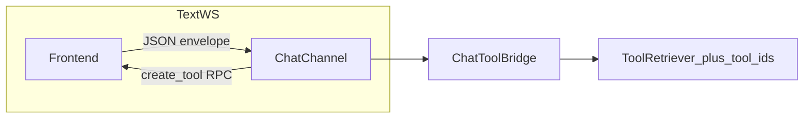

# Chat Frontend Tools Design

## Summary

Allow backend chat agents to invoke tools that execute in the connected
frontend (browser APIs and app UI actions). Tools are advertised dynamically by
the client over the same chat WebSocket used for the agent session. They are
injected into the playground `ToolRetriever` as ordinary in-memory tools for
that run.

SSE text chat is unchanged and does **not** support frontend tools. A new text
WebSocket carries one-shot text runs plus tool RPC. Voice
(`WEBSOCKET /api/chats/{chat_uuid}/voice/`) keeps Pipecat Protobuf media and
does **not** integrate frontend tools in this phase (deferred; dual control/media
WS may be revisited later).

## Goals

- Support browser-native capabilities and business UI actions as agent tools.
- Let the frontend dynamically register tools for the current WS session.
- Integrate tool call/result on the same session WebSocket (no SSE bypass, no
  separate control-plane socket).
- Cover text agent WS and voice agent WS in the first phase.
- Reuse playground `tool_backend.create_tool` + `tool_retriever.tools` +
  runtime `tool_ids` merging.
- Rely on the existing `chats:message:{uuid}` mutex for concurrent runs; do not
  keep a process-wide WebSocket connection registry.

## Non-Goals

- No SSE (`POST /api/chats/{uuid}/messages/`) support for frontend tools.
- No multi-turn text on one text WebSocket (one `user_message` then close).
- No HITL-only confirm protocol as a primary feature (may fall out of UI tools).
- No persisting frontend tools as `UserTool` DB rows / new `transport` values.
- No WebSocket connection registry (in-process or multi-worker).
- No replacing Pipecat transport with a custom audio stack.
- No demux FrameSerializer that mixes naked JSON text with protobuf on voice.

## Decisions

| Topic | Choice |
|-------|--------|
| Tool kinds | Browser APIs + business UI actions |
| Discovery | Frontend dynamic `register_tools` (full replace) |
| Transport | Same session WS; not SSE bypass |
| Text | New WS endpoint; one round then close |
| Voice | `/voice/` Pipecat WS; no frontend tools (deferred) |
| SSE | Untouched; no frontend-tool guarantee |
| Connection | Multiple WS allowed per `chat_uuid`; run-level mutex only |
| Deployment | No WS connection registry; run mutex only |
| Naming | `utils/chats/tools.py`, `ChatToolSpec`, `ChatToolBridge` |
| Session state | Owned by `ChatChannel` (no separate `ChatClientSession`) |

## Architecture



Voice (`/voice/`) is Pipecat media only and does not participate in frontend tools.

### Components

- **`ChatChannel`** ([`src/fivccliche/utils/chats/channels.py`](src/fivccliche/utils/chats/channels.py)):
  owns the socket, auth, JSON envelope send/receive, tool specs, pending RPC
  futures, and lifecycle state. Tool envelopes always use `send_json_async`.
- **`ChatToolSpec` / `ChatToolBridge`** ([`src/fivccliche/utils/chats/tools.py`](src/fivccliche/utils/chats/tools.py)):
  bridge specs to playground `Tool` instances whose handlers call
  `channel.invoke_tool_async(...)`.
- **Text WS router**: one-shot text agent run over JSON envelopes with client tools.
- **Voice path** ([`speeches.py`](src/fivccliche/utils/chats/speeches.py)):
  Pipecat Protobuf after `ready`; no frontend-tool registration or RPC.

### `ChatChannel` state machine

```text
CONNECTING → AUTHENTICATED → PREPARED → STREAMING → CLOSED
```

| State | Meaning | Allowed |
|-------|---------|---------|
| `CONNECTING` | Accepted; waiting for `auth` | Auth only |
| `AUTHENTICATED` | JWT OK; handshake | `register_tools` (text); voice `start` |
| `PREPARED` | Ready to run | Start run; optional final `register_tools` before `STREAMING` (text) |
| `STREAMING` | Agent / Pipecat active | Text tool RPC + stream; reject second run / register |
| `CLOSED` | Done | Cancel pending RPCs; clear specs |

Rules:

- Entering `PREPARED` (text): client must send `register_tools` once after auth
  (empty list allowed) → server `tools_ready` → `PREPARED`. Then `user_message`.
- Voice: `auth` → `start` → `ready` → `PREPARED` → `STREAMING` (no client tools).
- Text: `user_message` enters `STREAMING`; on `finish`/`error` → `CLOSED`.
- `register_tools` only in `AUTHENTICATED` / `PREPARED` (full list replace).
- Text tool envelopes stay JSON for the whole short-lived connection.

### Injection into agent runs

Existing playground hooks:

- `create_tool_retriever_async(..., tools=)` or post-write `tool_retriever.tools`
- Runtime `tool_ids` must include client tool names merged with
  `AgentConfig.tool_ids` (empty `tool_ids` alone is insufficient when agent
  configs already list tools / when bundles would be filtered).

Text path: build collaborators, inject via `tool_backend.create_tool` (signed
callable from `parameters`), stream events as JSON on the same WS (align with
`ChatRunParser`: `start` / `stream` / `tool` / `finish` / `error`).

Do not teach SSE or voice runs to use frontend tools.

## Protocol

Shared envelope (text WS wire format):

```json
{
  "v": 1,
  "type": "register_tools | tools_ready | tool_call | tool_result | user_message | start | stream | tool | finish | error | auth | ready | ...",
  "id": "rpc correlation id when needed",
  "payload": {}
}
```

Exact field names for legacy voice `auth` / `start` / `ready` remain compatible
with today's frames where already defined; new tool types use the envelope
above. Text WS may use the same `auth` first-frame pattern as voice.

### `register_tools` item

- `name`: constrained length and charset
- `description`: string
- `parameters`: JSON Schema object

Server responds `tools_ready` with accepted names; invalid items skipped with
warnings in payload.

### Tool RPC

- Server → client: `tool_call` `{ id, name, arguments }`
- Client → server: `tool_result` `{ id, ok, result | error }`
- Default wait 30s (optional override with a hard cap)
- Timeout / disconnect / unknown id → tool error string to the model

### Endpoints

| Path | Role |
|------|------|
| `WEBSOCKET /api/chats/{chat_uuid}/text/` | Text session (auth → register → one user_message → close) |
| `WEBSOCKET /api/chats/{chat_uuid}/voice/` | Voice Pipecat session; no frontend tools |
| `POST /api/chats/{chat_uuid}/messages/` | Unchanged SSE; no frontend tools |

Auth and chat Editable ownership match existing chat WS rules. Existing
`chats:message:{uuid}` mutex still prevents concurrent text/voice/SSE runs for
the same chat.

## Error handling

- Tool-level failures do not necessarily abort the whole run; return tool error
  and let the model continue when possible.
- Illegal state transitions: protocol `error` and close when appropriate.
- Concurrent agent runs on the same chat: existing `chats:message:{uuid}` mutex
  (`chat_busy` / 1008). No process-wide WS connection registry.
- Payload size limits on register schemas and tool results.

## Security

- First-frame JWT; chat must be editable by the user.
- Tool names sanitized; result/schema size capped.
- Session tools never written to global config repositories.
- Results only visible to the in-flight agent run on that channel.

## Testing

- Unit: `ChatChannel` state transitions; invoke/`tool_result` pairing and timeout.
- Unit: `ChatToolBridge` / `make_client_tool_callable` signature + `create_tool`.
- Integration: text WS register → mocked tool round-trip → finish → closed.
- Regression: SSE path and voice `/voice/` without client tools unchanged.

## Documentation

- [`docs/architecture.md`](../../architecture.md), [`docs/agent_speeches.md`](../../agent_speeches.md),
  [`docs/chat-frontend-tools.md`](../../chat-frontend-tools.md): text tools only;
  voice `/voice/` has no frontend tools.

## Implementation sketch (historical)

1. Extend `ChatChannel` with state enum, tool registry, RPC over JSON.
2. Add `utils/chats/tools.py` (`ChatToolSpec`, `ChatToolBridge`).
3. Add text WS endpoint and one-shot run loop.
4. Keep voice on `/voice/` without client-tool integration (deferred).
5. Tests + docs.

## Open follow-ups (explicitly deferred)

- Voice frontend tools (likely dual control/media WS).
- Multi-worker session routing.
- Text multi-turn on one WS.
- Deprecating SSE as the primary text UX.
